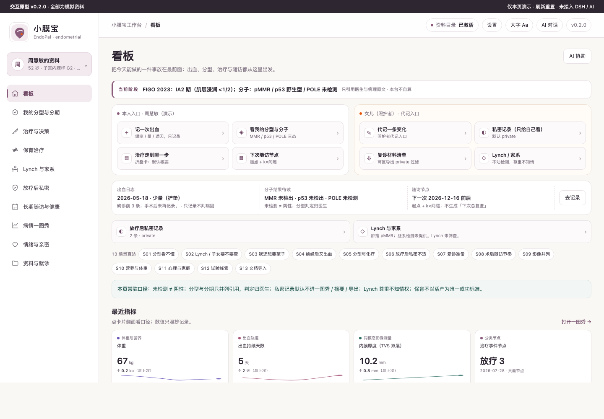
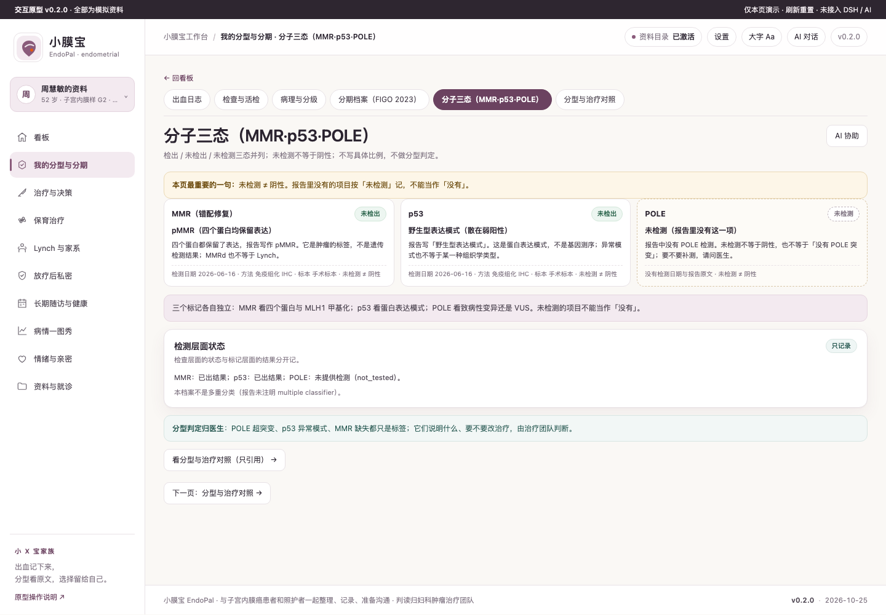
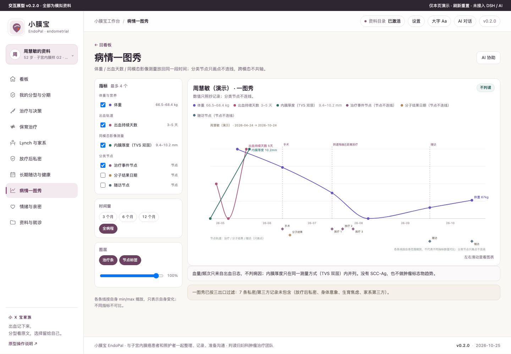
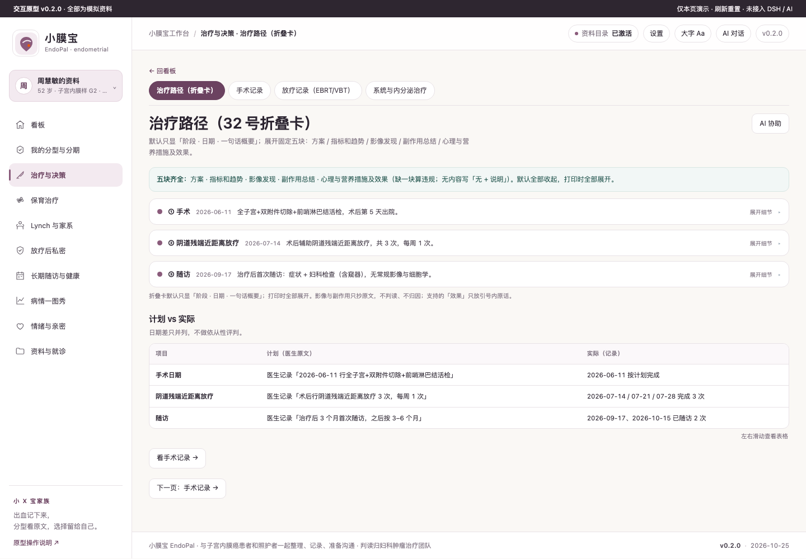
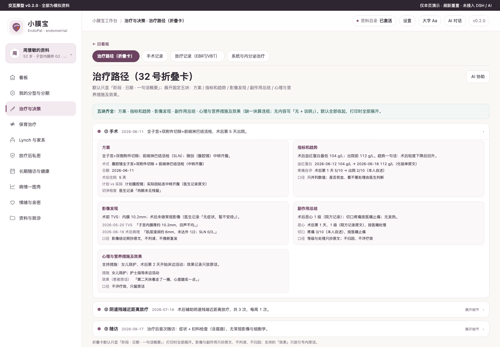
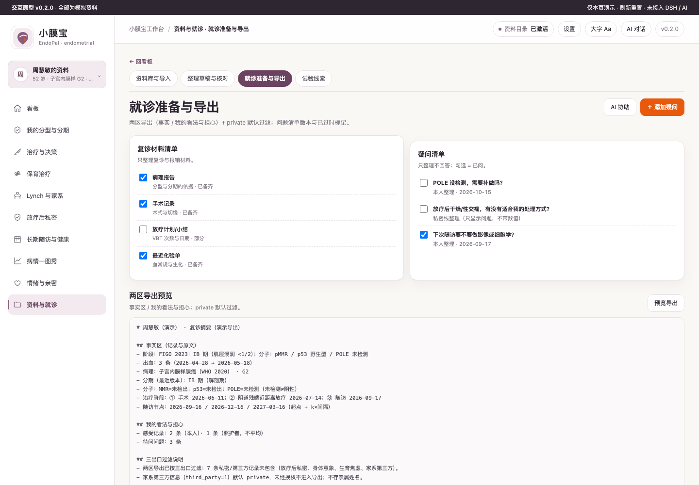

# 小膜宝 EndoPal · 子宫内膜癌患者工作台

面向子宫内膜癌患者与照护者：把**出血、分型、治疗、保育选择、Lynch 家系、放疗后私密与随访**放回一条时间线上，复诊时有据可查。

**不做声明**：不诊断、不判断疾病性质、不合成治疗建议、不判分型、不预测妊娠机会、不劝家属检测。所有判读归妇科肿瘤治疗团队；私密与家系第三方信息默认只存在本机。

## 关键功能

### 一眼看到「现在该做什么」
双主体入口（本人 / 照护者代记）+ 出血待记录、分子待读（未检测≠阴性）、随访节点三张状态卡。



### 分型看不懂时，先看三态与原文
MMR / p53 / POLE 各自独立：检出、未检出、**未检测**三态并列；未检测不等于阴性，分型判定归医生。



### 变化发生在哪一步
体重、出血天数、同模态内膜厚度放回同一段时间；分类节点只画点不连线。**没有 SCC-Ag，也不做肿瘤标志物趋势。**



### 治疗走到哪一步（默认概要）
阶段名 + 日期 + 一句话；不展开也能回答「下一步是什么」。



### 医生要细节时，点开就是五块
方案 / 指标和趋势 / 影像发现 / 副作用总结 / 心理与营养措施及效果；影像与副作用只抄原文，效果只放患者原话。



### 复诊只带该带的
两区导出（事实 / 我的看法与担心）；放疗后私密、身体意象、生育焦虑、家系第三方信息默认过滤，不进入导出。



## 怎么用

### 开发版（本机，真数据源）
```bash
npm start -- --workspace ~/Documents/EndoPalWorkspace   # http://127.0.0.1:4173/
npm run check                                            # 版本/语法/冻结/文案/列/单测/包/分期一致性
npm run probe:headless                                   # 64 页签 × 2 档案（API 数据源）
npm run check:hvt && npm run probe:resp                  # HVT X1–X4 / 窄宽 90 视图
```
资料只写在你选的目录（`xyb-endometrial.sqlite`，32 表），不会在包里或临时目录留文件。库里已有档案时不重复播种。

### 原型（视觉基准）
1. 双击打开 `prototypes/v0.2/index.html`（无需构建、无需联网；全部为演示数据）。
2. 左侧 10 条一级线、页内 30 个二级页签；看板 13 枚场景 chip 可直达。
3. 右上「AI 对话」可展开/收起；每页「AI 协助」会把提示词 + 本页病情上下文填入会话草稿（`endo:agent-draft`），**不会自动发送**。
4. 档案可在左上角切换：周慧敏（52 女，术后放疗后随访）/ 李思（31 女，保育治疗中）。

接入 DSH Desktop：`npm pack` 后在 Desktop 安装本地 tgz（profile 的 `dsh.profile.bundles` 加上包名），**重启宿主**后生效；首次先在左侧新建会话。装机实测属 M6，本轮未做，不写"装机通过"。

## 数据与口径

- **唯一数据源**：`demo/build-demo-data.mjs`（改数据只改它，重跑生成 `prototypes/v0.2/demo-data.js` 与 `demo/demo-data.json`）。两档案 × 6 个月（2026-04-24 → 2026-10-24）。
- **全部为合成演示数据**，人物、数值与时间线不指向任何真实患者；不构成诊疗建议。
- 分期：FIGO 2023（含分子标签）只做**版本链引用**（解剖期 + 最终标签 + 依据原文 + 日期 + 是否因分子改期），无 TNM→期别推导列。
- 出血日志是**独立轨道**：只记模式/量/天数/血块/排液/诱因，无病因、无疾病性质、无严重度列。
- 保育：零方案推荐、零概率数字；**没有活产也不后悔，是合理结局**——不以活产作为唯一成功标准。
- Lynch：肿瘤 MMR ≠ 胚系结论；家系只存关系/癌种/年龄/代号，`third_party=1` + `consent=1`，默认 `private`；**不知情也是合法选择**。
- 一图秀：Fritsch–Carlson 单调三次；各线按自身范围缩放、不可比；单点不连线；`.chart .line` 的 computed `fill` 必须是 `none`。
- 试验线索来自 `research/endometrial-cancer/trials-2026.jsonl` 的 2026-10 登记快照：登记状态未核实，NMPA 逐药「待核验」，不是推荐。
- 版本：`0.2.0`（`VERSION` / `package.json` / 原型首屏一致）。

## 开发

```bash
npm run demo:build      # 重新生成两档案 × 6 个月演示数据
npm run probe:proto     # 64 页签截图 + 溢出/error/禁词/必现句/computed fill
npm run probe:resp      # 8 档宽度 + AI 面板展开 × 10 一级页 = 90 视图
npm run check:hvt       # HVT X1–X4（覆盖/路径/编辑入口/AI 候选闭环）
npm run shots:readme    # 重新生成 docs/screenshots/ 的 6 张 README 截图
npm run check && npm test && npm run audit
```

当前自验数字：原型 64 页签 / 64 截图（`docs/shots/`）、HVT X1 30/30 无孤儿、X2 26 条路径、X3 32 视图（编辑 ≤1、表单 ≤6）、X4 AI 闭环 1111 + `endo:agent-draft`；`probe:resp` 90 视图溢出 0 / 竖排单字 0 / 裁切 0；禁词 0；computed `fill:none`。开发版（API 数据源）无头 64/64 页签、溢出 0、console error 0、4xx 0、AI 35/45/25；`npm run check` 37 项单测 + 37/37 家族 audit + 分期一致性；`npm run check:pack` 占位 0 / 四要素齐；`probe:install`（仓库副本）30/30。

文档索引：需求与 K1–K6 见 `docs/DEV-REQUIREMENTS-2026-10-25.md`；页面树权威见 `research-notes/family-landscape.md` §6.1–§6.3；交互与 CRUD 见 `docs/INTERACTION-DESIGN.md`；场景与流程见 `docs/SCENARIOS.md` / `docs/PATIENT-FLOW.md`；窄宽见 `docs/RESPONSIVE-RULES.md`；折叠卡与 README 截图见 `docs/32-TREATMENT-PATHWAY-FOLDOUT.md` / `docs/33-README-SCREENSHOTS.md`。
