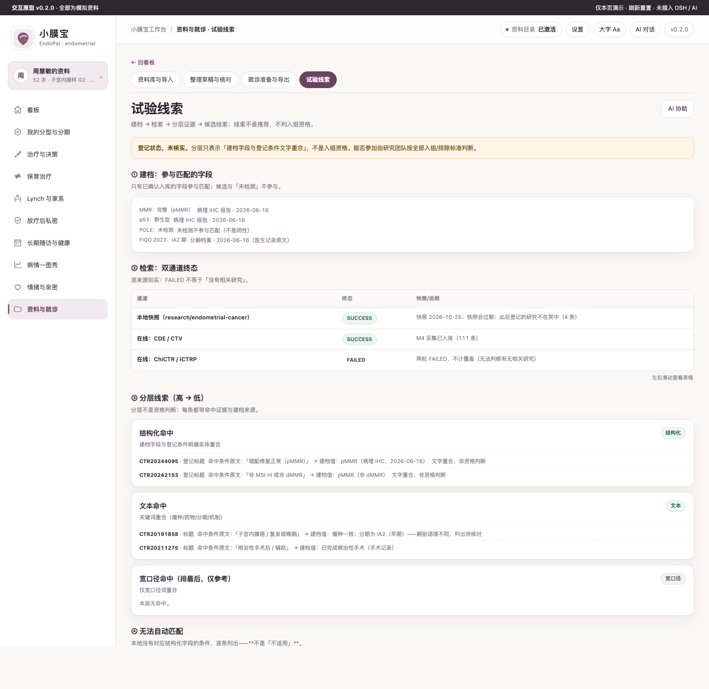

# 小膜宝 EndoPal · 子宫内膜癌患者工作台

面向子宫内膜癌患者与照护者：把**出血、分型、治疗、保育选择、Lynch 家系、放疗后私密与随访**放回一条时间线上，复诊时有据可查。

**不做声明**：不诊断、不判断疾病性质、不合成治疗建议、不判分型、不预测妊娠机会、不劝家属检测。所有判读归妇科肿瘤治疗团队；私密与家系第三方信息默认只存在本机。

## 疾病概要

> 四段固定：定义 → 医学资料规范和指南情况 → 目前治疗全景概要 → 发展趋势。整体属**解释层**（第 ② 层）：
> 只整理公开信息，不判断你的病情。工作台右上角的「?」看同一份内容的整页版。
> 原件状态照实写：FIGO 2025 更新拿到开放获取全文；FIGO 2023、NCCN 患者版 2026、ESGO 2025、
> 国家卫健委 2022 版、中国妇科肿瘤临床实践指南 2025、WHO 2020 均未取得原件，页码待核。

### 定义

子宫内膜癌是发生在子宫内膜上皮的恶性肿瘤。这个病的特点在分期上：2023 年起，期别不只看「长到哪」，还看组织学类型、分级、淋巴血管间隙浸润（LVSI）与分子分型。

病理类型按 WHO 2020 形态学分类命名：子宫内膜样癌、浆液性癌、透明细胞癌、癌肉瘤、未分化/去分化癌、混合性癌、中肾样癌、胃肠型黏液癌、神经内分泌癌等。「I 型 / II 型」是历史概念，不是今天病理报告的格式。组织学分级 G1 / G2 / G3 是显微镜下的分级，不是分期：对子宫内膜样癌按实性生长区比例（≤5% / 6–50% / >50%）。分期用 FIGO 2023，期别后可加 m 与分子型（例如 IAmPOLEmut、IICmp53abn）；分子分型是肿瘤的体细胞特征，不是遗传检测。本台只抄病理与分子报告的原文，不把「期别后面多了个 m」解释成严重或好转，也不自算期别。

**来源**：FIGO · Cancer of the corpus uteri: A 2025 update · 2025-09 · 原件已取得（开放获取全文，PMC12411821）｜ FIGO · FIGO staging of endometrial cancer: 2023 · 2023-08 · 未取得原件（全文付费，摘要与公开综述核对）· 页码待核 ｜ WHO · WHO 2020 形态学分类 · 2020 · 未取得原件（据 FIGO 2025 更新转引）· 页码待核

### 医学资料规范和指南情况

| 机构 | 文件 | 版本 / 年份 | 原件 | 本台的用途 |
|---|---|---|---|---|
| FIGO | Cancer of the corpus uteri: A 2025 update | 2025-09（开放获取全文） | 已取得（PMC 开放全文） | 症状评估、分子分型与分期规则、治疗语境、随访 |
| FIGO | FIGO staging of endometrial cancer: 2023 | 2023-08 | 未取得原件（全文付费，摘要与公开综述核对） | FIGO 2023 期别结构与 m 标签 |
| NCCN | NCCN Guidelines for Patients: Uterine Cancer, 2026（基于 Uterine Neoplasms V2.2026） | 2025-11-14（患者版） | 未取得原件 | 手术范围、辅助治疗选项、随访频率 |
| ESGO / ESTRO / ESP | ESGO-ESTRO-ESP guidelines: update 2025 | 2025-08 | 未取得原件（仅摘要，全文付费） | 与 FIGO 2023 分期的衔接 |
| 国家卫生健康委 | 子宫内膜癌诊疗指南（2022年版） | 2022-04 | 未取得原件（官网 412，正文用转载件核对） | 国内口径；采用 FIGO 2009 分期 |
| 中华医学会妇科肿瘤学分会 | 中国妇科肿瘤临床实践指南 2025——子宫内膜癌 | 2025-09-20 | 未取得原件（登录墙，仅概述） | 国内实践对照 |
| WHO | WHO 2020 形态学分类 | 2020 | 未取得原件（据 FIGO 2025 转引） | 组织学类型命名口径 |

同一病种里分期体系有两套：国内 FIGO 2023 与 2022 版国家指南采用的 FIGO 2009 并存。本表两行都列，不做换算。未取得原件的文件只记「存在」与「大致讲什么」，不引用其具体条文，页码写「页码待核」。「指南推荐」「中国获批」「医保报销」是三件事：本台把它们分字段显示，不合成一句话。

**来源**：见上表逐行。

### 目前治疗全景概要

按病期与线序列出指南里出现过的手段类别。这是「世界上大致有哪些办法」的地图，不是给你排的先后顺序，也不含剂量、疗程与适用条件——那些必须由医生按你的分期、病理与分子结果决定。

- **局限在子宫（以手术为主）**：手术——全子宫 + 双侧输卵管卵巢切除（TH+BSO）是常见范围；侵犯宫颈间质时可能需根治性子宫切除；局限在子宫的子宫内膜样癌，微创手术是常见路径。／淋巴结评估——前哨淋巴结活检（SLN）与淋巴结清扫两条路径都在指南里；影像/术中判断淋巴结阴性时，SLN 是可接受的做法。／年轻、病变局限、低危者可与医生讨论保留卵巢，不是所有患者都适合。／术后辅助治疗——按分期、组织学、分级、LVSI、切缘决定观察、阴道近距离放疗（VBT）、体外放疗（EBRT）或化疗。
- **局部晚期 / 晚期 / 复发**：系统治疗——化疗（常用卡铂 + 紫杉醇）与激素治疗按分期与病理类型列出；MMRd 与免疫检查点抑制剂联合在指南里有条目，p53abn 与化疗语境相关。／放疗——EBRT 与 VBT 可单独或与系统治疗联合使用。／特殊病理类型——浆液性癌、透明细胞癌、癌肉瘤按高风险类型处理，HER2 检测用于晚期/转移性浆液性癌或癌肉瘤。／临床研究——指南把「参加登记良好的临床试验」列为一项正式选项，不是最后手段。
- **需要单列的情形**：保育治疗（年轻未育）——前提是 G1 子宫内膜样癌、MRI 判断无肌层浸润；方案包括左炔诺孕酮宫内节育器（LNG-IUD）与口服孕激素，这是延迟手术、争取生育时间，不是治愈。／Lynch 综合征相关——所有子宫内膜癌建议做 MMR IHC 初筛；确认 Lynch 后涉及降风险手术与家系检测的讨论，属遗传咨询与医生判断。
- **贯穿全程的两件事**：随访节奏——治疗后前 2–3 年每 3–6 个月、第 4–5 年每 6–12 个月、第 5 年后每年（NCCN 患者版 2026；国内 2022 版表述一致）；无症状患者不做常规影像，阴道细胞学不推荐常规做。／放疗后性健康——阴道干燥、性交痛、阴道狭窄是常见副作用；阴道扩张器、保湿剂、润滑剂、阴道雌激素都有指南/共识语境，具体用法由医生定，本台默认私密、可选填、可跳过。

以上是文献与指南里列出的手段，按病期与线序排列，**不代表任何一项适合你**。选哪一个，这一句需要问你的医生。

**来源**：FIGO · Cancer of the corpus uteri: A 2025 update · 2025-09 · 原件已取得（PMC12411821）｜ NCCN · NCCN Guidelines for Patients: Uterine Cancer, 2026 · 2025-11-14 · 未取得原件 · 页码待核 ｜ 国家卫生健康委 · 子宫内膜癌诊疗指南（2022年版）· 2022-04 · 未取得原件 · 页码待核

### 发展趋势

只写已经发生的事，每条带日期或版本号。不预测、不评价、不给倾向。

- 2023-08：FIGO 发布子宫内膜癌 2023 分期，把分子分型写入期别（如 IAmPOLEmut、IICmp53abn）。
- 2025-08：ESGO / ESTRO / ESP 发布 2025 更新，纳入 FIGO 2023 分期（本项目仅取得摘要）。
- 2025-09：FIGO 发布 Cancer of the corpus uteri: A 2025 update（开放获取全文）。
- 2026-02-06 / 2026-02-07：据新华网与美通社报道，NMPA 批准帕博利珠单抗联合卡铂和紫杉醇用于 dMMR 原发晚期或复发性子宫内膜癌一线、随后单药维持；NMPA 官网送达信息页返回 HTTP 412，批件号未核实。
- 截至 2026-10-25：本项目采集到子宫内膜癌 2026 年登记 chinadrugtrials（CDE）49 条、ClinicalTrials.gov 62 条；chictr_online / ictrp 六个仓库状态为 FAILED（未查过，不计覆盖），阶段分布本台尚未统计。

**来源**：FIGO · FIGO staging of endometrial cancer: 2023 · 2023-08 · 未取得原件 · 页码待核 ｜ ESGO / ESTRO / ESP · ESGO-ESTRO-ESP guidelines: update 2025 · 2025-08 · 未取得原件（仅摘要）· 页码待核 ｜ 新华网 / 美通社 · 帕博利珠单抗在华获批原发晚期或复发性子宫内膜癌适应症 · 2026-02-06 / 2026-02-07 · 未取得原件 · 页码待核（NMPA 官网 412，批件号未核实）｜ chinadrugtrials（CDE）/ ClinicalTrials.gov · 2026 年子宫内膜癌试验登记采集 · 快照 2026-10-25 · 一手登记数据，本项目自采

## 关键功能

### 一眼看到「现在该做什么」
双主体入口（本人 / 照护者代记）+ 出血待记录、分子待读（未检测≠阴性）、随访节点三张状态卡。


### 分型看不懂时，先看三态与原文
MMR / p53 / POLE 各自独立：检出、未检出、**未检测**三态并列；未检测不等于阴性，分型判定归医生。


### 变化发生在哪一步
体重、出血天数、同模态内膜厚度放回同一段时间；分类节点只画点不连线。**没有 SCC-Ag，也不做肿瘤标志物趋势。**


### 治疗走到哪一步（默认概要）
阶段名 + 日期 + 一句话；不展开也能回答「下一步是什么」。


### 医生要细节时，点开就是五块
方案 / 指标和趋势 / 影像发现 / 副作用总结 / 心理与营养措施及效果；影像与副作用只抄原文，效果只放患者原话。


### 复诊只带该带的
两区导出（事实 / 我的看法与担心）；放疗后私密、身体意象、生育焦虑、家系第三方信息默认过滤，不进入导出。


### 临床试验：建档 → 检索 → 分层证据 → 候选线索

只有**已确认入库**的分子/病理字段参与匹配；双通道逐来源如实（FAILED 不等于「没有相关研究」）；结果分「结构化命中 / 文本命中 / 宽口径」三层，每条带命中条件原文与建档来源；本地没建档的条件列入「无法自动匹配」——**永不写「你不适合 / 你能入组」**，是否参加由研究团队按全部入组/排除标准判断。

## 怎么用

### 开发版（本机，真数据源）
```bash
npm start -- --workspace ~/Documents/EndoPalWorkspace   # http://127.0.0.1:4173/
npm run check                                            # 版本/语法/冻结/文案/列/单测/包/分期一致性
npm run probe:headless                                   # 64 页签 × 2 档案（API 数据源）
npm run check:hvt && npm run probe:resp                  # HVT X1–X4 / 窄宽 90 视图
```
资料只写在你选的目录（`xyb-endometrial.sqlite`，32 表），不会在包里或临时目录留文件。库里已有档案时不重复播种。

### 原型（视觉基准）
1. 双击打开 `prototypes/v0.2/index.html`（无需构建、无需联网；全部为演示数据）。
2. 左侧 10 条一级线、页内 30 个二级页签；看板 13 枚场景 chip 可直达。
3. 右上「AI 对话」可展开/收起；每页「AI 协助」会把提示词 + 本页病情上下文填入会话草稿（`endo:agent-draft`），**不会自动发送**。
4. 档案可在左上角切换：周慧敏（52 女，术后放疗后随访）/ 李思（31 女，保育治疗中）。

接入 DSH Desktop：`npm pack` 后在 Desktop 安装本地 tgz（profile 的 `dsh.profile.bundles` 加上包名），**重启宿主**后生效；首次先在左侧新建会话。装机实测属 M6，本轮未做，不写"装机通过"。

## 数据与口径

- **唯一数据源**：`demo/build-demo-data.mjs`（改数据只改它，重跑生成 `prototypes/v0.2/demo-data.js` 与 `demo/demo-data.json`）。两档案 × 6 个月（2026-04-24 → 2026-10-24）。
- **全部为合成演示数据**，人物、数值与时间线不指向任何真实患者；不构成诊疗建议。
- 分期：FIGO 2023（含分子标签）只做**版本链引用**（解剖期 + 最终标签 + 依据原文 + 日期 + 是否因分子改期），无 TNM→期别推导列。
- 出血日志是**独立轨道**：只记模式/量/天数/血块/排液/诱因，无病因、无疾病性质、无严重度列。
- 保育：零方案推荐、零概率数字；**没有活产也不后悔，是合理结局**——不以活产作为唯一成功标准。
- Lynch：肿瘤 MMR ≠ 胚系结论；家系只存关系/癌种/年龄/代号，`third_party=1` + `consent=1`，默认 `private`；**不知情也是合法选择**。
- 一图秀：Fritsch–Carlson 单调三次；各线按自身范围缩放、不可比；单点不连线；`.chart .line` 的 computed `fill` 必须是 `none`。
- 试验线索来自 `research/endometrial-cancer/trials-2026.jsonl` 的 2026-10 登记快照：登记状态未核实，NMPA 逐药「待核验」，不是推荐。
- 版本：`0.2.0`（`VERSION` / `package.json` / 原型首屏一致）。

## 开发

```bash
npm run demo:build      # 重新生成两档案 × 6 个月演示数据
npm run probe:proto     # 64 页签截图 + 溢出/error/禁词/必现句/computed fill
npm run probe:resp      # 8 档宽度 + AI 面板展开 × 10 一级页 = 90 视图
npm run check:hvt       # HVT X1–X4（覆盖/路径/编辑入口/AI 候选闭环）
npm run shots:readme    # 重新生成 docs/screenshots/ 的 6 张 README 截图
npm run check && npm test && npm run audit
```

当前自验数字：原型 64 页签 / 64 截图（`docs/shots/`）、HVT X1 30/30 无孤儿、X2 26 条路径、X3 32 视图（编辑 ≤1、表单 ≤6）、X4 AI 闭环 1111 + `endo:agent-draft`；`probe:resp` 90 视图溢出 0 / 竖排单字 0 / 裁切 0；禁词 0；computed `fill:none`。开发版（API 数据源）无头 64/64 页签、溢出 0、console error 0、4xx 0、AI 35/45/25；`npm run check` 37 项单测 + 37/37 家族 audit + 分期一致性；`npm run check:pack` 占位 0 / 四要素齐；`probe:install`（仓库副本）30/30。

文档索引：需求与 K1–K6 见 `docs/DEV-REQUIREMENTS-2026-10-25.md`；页面树权威见 `research-notes/family-landscape.md` §6.1–§6.3；交互与 CRUD 见 `docs/INTERACTION-DESIGN.md`；场景与流程见 `docs/SCENARIOS.md` / `docs/PATIENT-FLOW.md`；窄宽见 `docs/RESPONSIVE-RULES.md`；折叠卡与 README 截图见 `docs/32-TREATMENT-PATHWAY-FOLDOUT.md` / `docs/33-README-SCREENSHOTS.md`。
